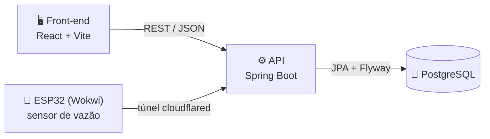
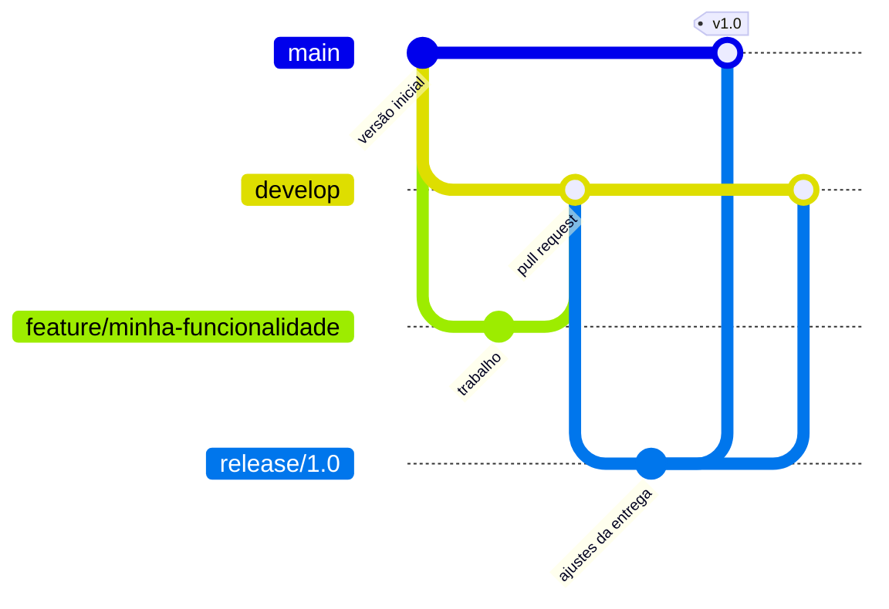

<p align="center">
  
</p>

<h1 align="center">Águas do Capibaribe</h1>

<p align="center">
  <strong>Cada lote com a água que ele precisa. Nem uma gota a mais.</strong><br>
  Gestão do consumo de água por lote em lavanderias de jeans do Agreste Pernambucano.
</p>

<p align="center">
  <a href="https://github.com/paulomourz/aguas-do-capibaribe/actions/workflows/ci.yml"></a>
  
  
  
  
  
  
  
</p>

<p align="center">
  <a href="#-sobre-o-projeto">Sobre</a> ·
  <a href="#-funcionalidades">Funcionalidades</a> ·
  <a href="#-arquitetura">Arquitetura</a> ·
  <a href="#-como-rodar">Como rodar</a> ·
  <a href="#-testes">Testes</a> ·
  <a href="#-status">Status</a> ·
  <a href="#-fluxo-de-trabalho-gitflow">GitFlow</a> ·
  <a href="#-equipe">Equipe</a>
</p>

---

## 💧 Sobre o projeto

As lavanderias de jeans de **Toritama**, **Caruaru** e **Santa Cruz do Capibaribe** consomem muita
água e quase sempre sem controle por processo de lavagem. O **Águas do Capibaribe** compara, lote a
lote, a água gasta com a meta de cada processo e avisa quando o consumo foge do esperado.

> Projeto Integrador do Senac. Os relatórios são gerenciais e não têm validade jurídica.

📘 **Guia completo em PDF** (como o sistema funciona e como rodar):
[`docs/guia/guia-aguas-do-capibaribe.pdf`](docs/guia/guia-aguas-do-capibaribe.pdf)

## ✨ Funcionalidades

| | Funcionalidade | Como funciona |
|---|---|---|
| 🎯 | **Metas por processo** | Litros por lote ou por peça para cada processo (estonagem, tingimento, amaciamento…) |
| 📝 | **Registro de lotes** | Digitado pelo operador ou enviado pelo sensor; o banco calcula o esperado |
| 📊 | **Desvio automático** | Realizado × meta em %, com faixas dentro da meta, atenção e crítico |
| 🚨 | **Alertas** | Abertos quando 3 lotes seguidos do mesmo processo passam da meta |
| 📈 | **Dashboard e relatório mensal** | Meta × real por processo, com impressão do relatório |
| 👥 | **Perfis** | Gestor (configura e acompanha tudo) e operador (registra lotes) |
| 📡 | **Sensor IoT** | ESP32 simulado no Wokwi mede a vazão e envia o lote pela API |

## 🧱 Arquitetura



- O front-end **nunca** acessa o banco: tudo passa pela API.
- O ESP32 simulado é só mais um cliente da API: faz login e envia o lote.
- O esquema é versionado com Flyway: as migrações em
  [`backend/src/main/resources/db/migration/`](backend/src/main/resources/db/migration/) são aplicadas
  pela API ao subir ([`database/LEIA-ME.md`](database/LEIA-ME.md)).

### Estrutura do repositório

| Pasta | Conteúdo |
|---|---|
| `/` (raiz) | Front-end React 19 + Vite + Tailwind (estrutura exigida pelo Figma Make) |
| [`backend/`](backend/README.md) | API REST em Java 25 LTS + Spring Boot 3.5 |
| [`database/`](database/LEIA-ME.md) | Guia do banco PostgreSQL e script do usuário `aguas_api` (as migrações Flyway ficam no `backend/`) |
| [`iot/`](iot/LEIA-ME.md) | Sensor de vazão simulado no Wokwi (ESP32): código, circuito e guia |
| [`docs/`](docs/README.md) | [Guia em PDF](docs/guia/), [endpoints da API](docs/tecnico/api.md), [banco e servidor](docs/tecnico/banco-remoto.md) e [gestão](docs/gestao/LEIA-ME.md) |
| `public/` | Arquivos servidos como estão (favicon) |
| `.figma/` | Configuração do Figma Make. Não editar |
| [`CHANGELOG.md`](CHANGELOG.md) | Histórico de versões |

## 🚀 Como rodar

> [!IMPORTANT]
> **Num PC novo, comece pela `develop`.** O GitHub abre na `main`, que só recebe as versões entregues;
> o trabalho do dia a dia está na `develop`.
>
> ```bash
> git clone https://github.com/paulomourz/aguas-do-capibaribe.git
> cd aguas-do-capibaribe
> git checkout develop
> ```
>
> Depois siga os passos abaixo: requisitos, banco, API e front-end. O banco do seu PC começa só com a
> estrutura e os processos iniciais das migrações, e os arquivos de senha (`backend/.env`, `.env.local`) não vêm do GitHub:
> cada pessoa cria os seus a partir dos `.env.example`.

### Com Docker (um comando só)

Precisa apenas do Docker com o Docker Compose. Na raiz do projeto:

```bash
docker compose up -d --build
docker compose logs segredos   # mostra o login e a senha inicial do administrador
```

O site abre em <http://localhost:3000> e o Swagger em <http://localhost:3000/api/swagger-ui.html>. A primeira
subida baixa as imagens e compila tudo, então precisa de internet e demora alguns minutos.

- **Banco próprio:** é separado do PostgreSQL instalado no PC e já vem com os processos iniciais.
- **Senhas:** são sorteadas na primeira subida e ficam só em um volume do Docker, fora do Git.
- **Parar:** `docker compose down` mantém os dados. Com `docker compose down -v`, os dados e as senhas são **apagados**.
- **IoT simulado:** aponte o túnel para o site (`cloudflared tunnel --url http://localhost:3000`). O `/api` continua igual.

Para rodar sem Docker, siga os passos abaixo.

### Requisitos

| Ferramenta | Versão | Para quê |
|---|---|---|
| JDK | 25 (LTS) ou mais novo | API |
| Maven | 3.9 ou mais novo | API |
| PostgreSQL | 18 | banco |
| Node.js | 22 ou mais novo | front-end |
| pnpm | 10 | front-end (`npx pnpm@10` também serve) |
| cloudflared | qualquer | só para o IoT simulado |

### 1. Banco de dados

Crie um banco vazio, aplique as migrações do Flyway e crie o usuário da aplicação (`aguas_api`, sem
permissão de apagar dados nem de mudar a estrutura). Escolha uma senha para ele: é a que vai no
`DB_PASSWORD` do `backend/.env`. PowerShell, dentro de `backend/`:

```powershell
psql -U postgres -c "create database aguas"
$env:FLYWAY_URL = "jdbc:postgresql://localhost:5432/aguas"; $env:FLYWAY_USER = "postgres"; $env:FLYWAY_PASSWORD = "<senha do postgres>"
mvn flyway:migrate
psql -U postgres -d aguas -v ON_ERROR_STOP=1 -v papel=aguas_api -v banco=aguas -v senha='<senha do aguas_api>' -f ../database/seguranca-usuario-api.sql
```

No fim, o último comando mostra o que o `aguas_api` pode fazer em cada tabela (nenhum `delete`).

> **Já tem o banco de antes do Flyway (criado pelo antigo `banco.sql`)?** Não recrie: na primeira subida
> da API nova, use `FLYWAY_BASELINE=true` uma vez
> ([`database/LEIA-ME.md`](database/LEIA-ME.md#banco-que-já-existia-antes-do-flyway-o-aguas)).

O banco começa sem usuários. Na primeira inicialização, a API cria o administrador principal
`capibaribe.admin` com a senha de `ADMIN_SENHA` ([detalhes](backend/README.md#administrador-principal));
os outros usuários são criados na tela **Usuários**.

> **Banco oficial:** o `aguas` tem dois usuários fixos, `capibaribe.admin` (administrador do site) e
> `sensor.wokwi` (sensor). Os processos reais são cadastrados pelo site. As senhas ficam fora do Git.
> Situação atual: [`docs/tecnico/banco-remoto.md`](docs/tecnico/banco-remoto.md#6-situação-atual).

### 2. API

```bash
cd backend
cp .env.example .env     # preencha banco (DB_USER=aguas_api), FLYWAY_USER/FLYWAY_PASSWORD, JWT_SECRET, ADMIN_SENHA e CORS_ORIGINS
mvn spring-boot:run      # http://localhost:8080/api
```

Com a API no ar, a documentação interativa (Swagger) fica em
**http://localhost:8080/api/swagger-ui.html**: lista as 16 rotas e permite testá-las no navegador.
Configuração completa, regras implementadas e testes: [`backend/README.md`](backend/README.md).

### 3. Front-end

```bash
pnpm install
pnpm dev                 # http://localhost:8443
```

O site **sempre usa a API**: sem configuração nenhuma, ele procura em `http://localhost:8080/api`. Se a
API estiver em outro endereço, ou para pôr o nome da lavanderia no relatório em PDF, crie o
`.env.local` na raiz a partir do `.env.example` (salve em UTF-8 sem BOM):

```
VITE_API_URL=http://localhost:8080/api
VITE_NOME_LAVANDERIA=Nome da lavanderia
```

Com a API desligada, o site avisa "Não foi possível conectar ao servidor." em vez de quebrar.

> **Modo simulado (só para demonstração sem back-end):** com `VITE_USAR_MOCK=true` no `.env.local`, o
> site usa dados de exemplo em memória, nada é gravado, e uma faixa amarela no topo avisa isso. Logins:
> `gestor.demo` ou `operador01`, senha `capibaribe`. Não use em entregas.

### 4. IoT simulado (opcional)

Um ESP32 no [Wokwi](https://wokwi.com) mede a vazão, conta os litros do lote e envia o lote para a API
por um túnel do cloudflared. Guia completo: [`iot/LEIA-ME.md`](iot/LEIA-ME.md).

## 🧪 Testes

```bash
cd backend
mvn test
```

| Conjunto | Precisa de banco? | Cobre |
|---|---|---|
| `RegraDeAlertaTest`, `RegrasSimplesTest` | não | regra dos 3 lotes, transições de status, desvio, CORS, JWT |
| `SegurancaWebTest` | não | 401/403 por perfil, validações, formato de erro |
| `ProcessoControllerTest` | não | meta zero ou negativa e nome repetido no cadastro de processos |
| `IntegracaoPostgres*Test` | Docker ou banco temporário `*_teste` | fluxo completo num banco real |
| `CicloCompletoLavanderiaE2ETest` | Docker ou banco temporário `*_teste` | jornada completa por HTTP: login, processo, operador, lotes, alerta e relatório |

São 60 testes: 41 unitários e de web + 19 de integração com PostgreSQL 18 (o banco começa vazio e o
Flyway aplica todas as migrações). Os de integração usam um
banco temporário, criado e apagado na hora, **nunca** o `aguas`. Passo a passo em
[`backend/README.md`](backend/README.md#testes).

A CI ([`.github/workflows/ci.yml`](.github/workflows/ci.yml)) roda em todo push e PR para `main` e
`develop`: `backend-test` (os 60 testes, no Java 25) e `frontend-build` (`tsc --noEmit` e `pnpm build`).
Não faça merge com check vermelho.

## 📌 Status

Versão atual: **v0.1.0-alpha** (27/10/2026). O que entrou em cada versão está no
[`CHANGELOG.md`](CHANGELOG.md). Comparado ao [Termo de Abertura v2.1](docs/gestao/TAP.pdf) (20/10/2026):

**Pronto**

- ✅ Login, perfis (gestor/operador), gestão de usuários e da própria conta, sempre contra a API real
- ✅ Gestor redefine a senha de outra pessoa, com registro de auditoria (quem fez, em quem e quando)
- ✅ Processos e metas
- ✅ Registro de lote com desvio e histórico por perfil
- ✅ Alertas (3 lotes seguidos acima da meta) com status
- ✅ Dashboard e relatório mensal, com download direto em PDF
- ✅ IoT fase 1: ESP32 simulado no Wokwi enviando lotes, encontrando o processo pelo nome
- ✅ Identidade visual "sertão e água", com navegação por teclado e contraste WCAG 2.1 AA
- ✅ Documentação interativa da API (Swagger) em `/api/swagger-ui.html`
- ✅ API conectada ao banco com o usuário restrito `aguas_api` (sem apagar dados nem mudar tabelas)
- ✅ Versionamento do banco com migrações Flyway (V1 a V4), aplicadas ao subir a API

**Próximos passos**

O que falta fazer está nas [**Issues do GitHub**](https://github.com/paulomourz/aguas-do-capibaribe/issues),
abertas pelo orientador, com prioridade e critérios de aceitação. Entre elas:

- 🟡 Status verde/amarelo/vermelho: lotes já vêm classificados pela API; falta fechar os limites oficiais e levar totais e médias para o back-end
- ⬜ Testes de aceitação
- ⬜ Inativar processo
- ⬜ API publicada num endereço fixo (semana 5)

## 🌿 Fluxo de trabalho (GitFlow)



| Branch | Para quê | Sai de | Volta para |
|---|---|---|---|
| `main` | versão entregue/apresentável. Ninguém faz commit direto | — | — |
| `develop` | integração do que está pronto | `main` | — |
| `feature/<nome>` | uma funcionalidade ou ajuste (ex.: `feature/inativar-processo`) | `develop` | `develop` (pull request) |
| `release/<versão>` | preparar uma entrega (ex.: `release/1.0`) | `develop` | `main` e `develop` |
| `hotfix/<nome>` | correção urgente no que já foi entregue | `main` | `main` e `develop` |

```bash
git checkout develop && git pull
git checkout -b feature/minha-funcionalidade
# ...commits...
git push -u origin feature/minha-funcionalidade
# abra um pull request para develop no GitHub
```

Antes do pull request, rode `mvn test` (back-end) e `pnpm build` (front-end).

**Trabalhando numa issue:**

1. Crie a branch a partir da `develop` (ex.: `feature/status-na-api`) e escreva `Closes #N` na
   descrição do pull request.
2. Como o pull request entra na `develop` (e não na `main`), o GitHub **não fecha a issue sozinho**.
   Depois do merge, feche a issue com um comentário apontando o PR.
3. **Mudou o banco?** Crie uma migração nova (`V5__descricao.sql`, o próximo número) em
   `backend/src/main/resources/db/migration/`. **Nunca edite uma migração que já está na `develop`**:
   o Flyway confere o checksum e a API não sobe. Registre a mudança no [`CHANGELOG.md`](CHANGELOG.md).
   Passo a passo no [`database/LEIA-ME.md`](database/LEIA-ME.md#mudou-o-banco-crie-uma-migração-nova).
4. Depois do `git pull` na `develop`, não precisa rodar nada no banco: a API aplica as migrações novas
   ao subir.

> [!WARNING]
> **Nunca suba segredos.** `backend/.env`, `.env.local` e `docs/privado/` estão no `.gitignore`.
> Senhas, `JWT_SECRET` e dados do banco ficam só nesses arquivos.

## 👥 Equipe

| Nome | Papel |
|---|---|
| Pedro | Full Stack / PO |
| Abraão Filipe | Back-end |
| João Bezerra | Back-end |
| Matheus Andrade | Front-end |
| Mateus Basilio | Banco de dados |
| Paulo Moura | DevOps |
| Fabio Cesar Figueiredo de Medeiros Chicout | Orientador |
