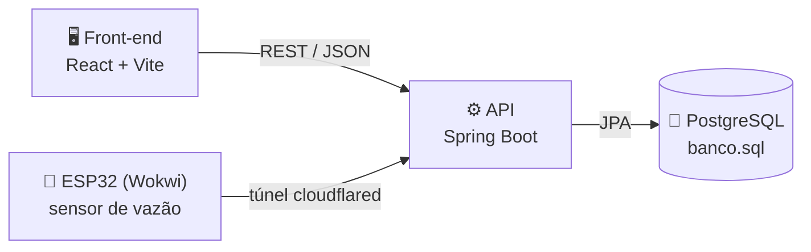
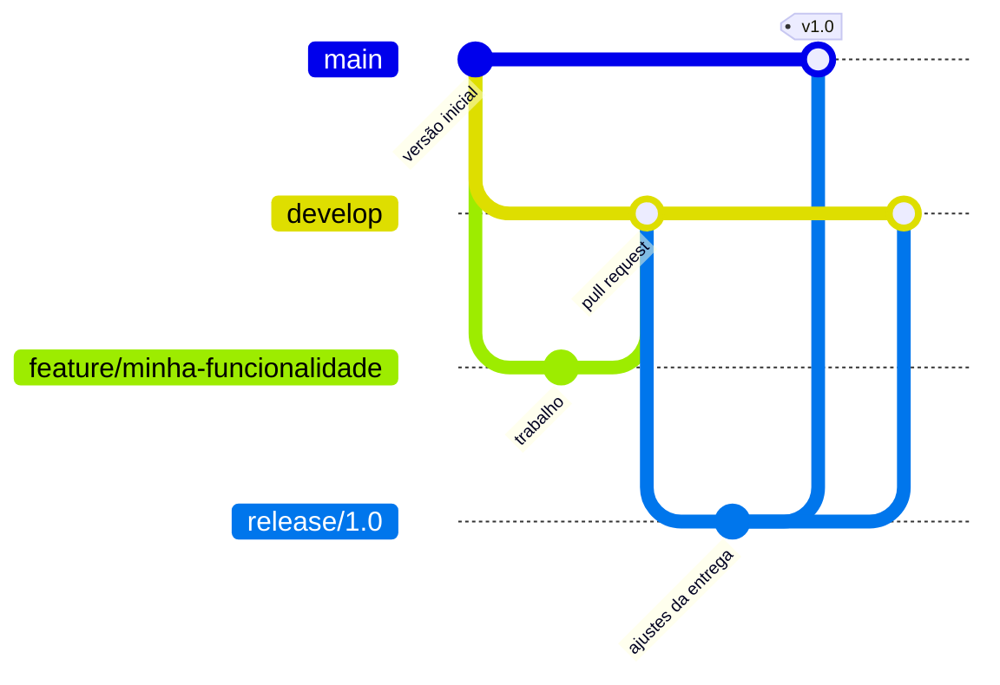

<p align="center">
  
</p>

<h1 align="center">Águas do Capibaribe</h1>

<p align="center">
  <strong>Cada lote com a água que ele precisa. Nem uma gota a mais.</strong><br>
  Gestão do consumo de água por lote em lavanderias de jeans do Agreste Pernambucano.
</p>

<p align="center">
  
  
  
  
  
  
  
</p>

<p align="center">
  <a href="#-sobre-o-projeto">Sobre</a> ·
  <a href="#-funcionalidades">Funcionalidades</a> ·
  <a href="#-arquitetura">Arquitetura</a> ·
  <a href="#-como-rodar">Como rodar</a> ·
  <a href="#-testes">Testes</a> ·
  <a href="#-status">Status</a> ·
  <a href="#-fluxo-de-trabalho-gitflow">GitFlow</a> ·
  <a href="#-equipe">Equipe</a>
</p>

---

## 💧 Sobre o projeto

As lavanderias de jeans de **Toritama**, **Caruaru** e **Santa Cruz do Capibaribe** consomem muita
água e quase sempre sem controle por processo de lavagem. O **Águas do Capibaribe** compara, lote a
lote, a água gasta com a meta de cada processo e avisa quando o consumo foge do esperado.

> Projeto Integrador do Senac. Os relatórios são gerenciais e não têm validade jurídica.

📘 **Guia completo em PDF** (como o sistema funciona e como rodar):
[`docs/guia/guia-aguas-do-capibaribe.pdf`](docs/guia/guia-aguas-do-capibaribe.pdf)

## ✨ Funcionalidades

| | Funcionalidade | Como funciona |
|---|---|---|
| 🎯 | **Metas por processo** | Litros por lote ou por peça para cada processo (estonagem, tingimento, amaciamento…) |
| 📝 | **Registro de lotes** | Digitado pelo operador ou enviado pelo sensor; o banco calcula o esperado |
| 📊 | **Desvio automático** | Realizado × meta em %, com faixas dentro da meta, atenção e crítico |
| 🚨 | **Alertas** | Abertos quando 3 lotes seguidos do mesmo processo passam da meta |
| 📈 | **Dashboard e relatório mensal** | Meta × real por processo, com impressão do relatório |
| 👥 | **Perfis** | Gestor (configura e acompanha tudo) e operador (registra lotes) |
| 📡 | **Sensor IoT** | ESP32 simulado no Wokwi mede a vazão e envia o lote pela API |

## 🧱 Arquitetura



- O front-end **nunca** acessa o banco: tudo passa pela API.
- O ESP32 simulado é só mais um cliente da API: faz login e envia o lote.
- A API não cria nem altera tabelas: o esquema é o de [`database/banco.sql`](database/banco.sql).

### Estrutura do repositório

| Pasta | Conteúdo |
|---|---|
| `/` (raiz) | Front-end React 19 + Vite + Tailwind (estrutura exigida pelo Figma Make) |
| [`backend/`](backend/README.md) | API REST em Java 25 LTS + Spring Boot 3.5 |
| [`database/`](database/LEIA-ME.md) | Esquema PostgreSQL (`banco.sql`, dump do PostgreSQL 18.6) |
| [`iot/`](iot/LEIA-ME.md) | Sensor de vazão simulado no Wokwi (ESP32): código, circuito e guia |
| [`docs/`](docs/README.md) | [Guia em PDF](docs/guia/), [endpoints da API](docs/tecnico/api.md), [banco e servidor](docs/tecnico/banco-remoto.md) e [gestão](docs/gestao/LEIA-ME.md) |
| `public/` | Arquivos servidos como estão (favicon) |
| `.figma/` | Configuração do Figma Make. Não editar |

## 🚀 Como rodar

### Requisitos

| Ferramenta | Versão | Para quê |
|---|---|---|
| JDK | 25 (LTS) ou mais novo | API |
| Maven | 3.9 ou mais novo | API |
| PostgreSQL | 18 | banco (o `psql` precisa ser 18+ por causa do dump) |
| Node.js | 22 ou mais novo | front-end |
| pnpm | 10 | front-end (`npx pnpm@10` também serve) |
| cloudflared | qualquer | só para o IoT simulado |

### 1. Banco de dados

Crie um banco vazio e aplique o esquema:

```bash
psql -U postgres -c "create database aguas"
psql -U postgres -d aguas -v ON_ERROR_STOP=1 -f database/banco.sql
```

O banco começa vazio. Na primeira inicialização, a API cria o administrador principal
`capibaribe.admin` com a senha de `ADMIN_SENHA` ([detalhes](backend/README.md#administrador-principal));
os outros usuários são criados na tela **Usuários**.

> **Banco oficial:** o `aguas` tem dois usuários fixos, `capibaribe.admin` (administrador do site) e
> `sensor.wokwi` (sensor). Os processos reais são cadastrados pelo site. As senhas ficam fora do Git.
> Situação atual: [`docs/tecnico/banco-remoto.md`](docs/tecnico/banco-remoto.md#6-situação-atual-20102026).

### 2. API

```bash
cd backend
cp .env.example .env     # preencha banco, JWT_SECRET e CORS_ORIGINS
mvn spring-boot:run      # http://localhost:8080/api
```

Configuração completa, regras implementadas e testes: [`backend/README.md`](backend/README.md).

### 3. Front-end

Na raiz, crie `.env.local` a partir de `.env.example`:

```
VITE_USAR_MOCK=false
VITE_API_URL=http://localhost:8080/api
```

```bash
pnpm install
pnpm dev                 # http://localhost:8443
```

> [!TIP]
> Salve o `.env.local` em **UTF-8 sem BOM** (no VS Code, canto inferior direito). Com BOM, o Vite não
> reconhece a primeira linha, o site cai no modo simulado e o login do admin dá "senha incorreta".

Sem o `.env.local`, o front roda no **modo simulado**: dados de exemplo em memória, sem API. Logins de
demonstração: `gestor.demo` ou `operador01`, senha `capibaribe` (só funcionam no modo simulado).

### 4. IoT simulado (opcional)

Um ESP32 no [Wokwi](https://wokwi.com) mede a vazão, conta os litros do lote e envia o lote para a API
por um túnel do cloudflared. Guia completo: [`iot/LEIA-ME.md`](iot/LEIA-ME.md).

## 🧪 Testes

```bash
cd backend
mvn test
```

| Conjunto | Precisa de banco? | Cobre |
|---|---|---|
| `RegraDeAlertaTest`, `RegrasSimplesTest` | não | regra dos 3 lotes, transições de status, desvio, CORS, JWT |
| `SegurancaWebTest` | não | 401/403 por perfil, validações, formato de erro |
| `IntegracaoPostgres*Test` | Docker ou banco temporário `*_teste` | fluxo completo num banco real |

São 40 testes: 25 unitários e de web + 15 de integração com PostgreSQL 18. Os de integração usam um
banco temporário, criado e apagado na hora, **nunca** o `aguas`. Passo a passo em
[`backend/README.md`](backend/README.md#testes).

## 📌 Status

Comparado ao [Termo de Abertura v2.1](docs/gestao/TAP.pdf) (20/10/2026).

**Pronto**

- ✅ Login, perfis (gestor/operador), gestão de usuários e da própria conta
- ✅ Gestor redefine a senha de outra pessoa
- ✅ Processos e metas
- ✅ Registro de lote com desvio e histórico por perfil
- ✅ Alertas (3 lotes seguidos acima da meta) com status
- ✅ Dashboard e relatório mensal
- ✅ IoT fase 1: ESP32 simulado no Wokwi enviando lotes, encontrando o processo pelo nome
- ✅ Identidade visual "sertão e água"

**Próximos passos**

- 🟡 Exportar o relatório em PDF (hoje pelo "Imprimir" do navegador)
- 🟡 Status verde/amarelo/vermelho calculado no back-end (hoje só no front)
- ⬜ Inativar processo
- ⬜ API conectando com usuário próprio (`aguas_api`) em vez de `postgres`
- ⬜ API publicada num endereço fixo (semana 5)

## 🌿 Fluxo de trabalho (GitFlow)



| Branch | Para quê | Sai de | Volta para |
|---|---|---|---|
| `main` | versão entregue/apresentável. Ninguém faz commit direto | — | — |
| `develop` | integração do que está pronto | `main` | — |
| `feature/<nome>` | uma funcionalidade ou ajuste (ex.: `feature/inativar-processo`) | `develop` | `develop` (pull request) |
| `release/<versão>` | preparar uma entrega (ex.: `release/1.0`) | `develop` | `main` e `develop` |
| `hotfix/<nome>` | correção urgente no que já foi entregue | `main` | `main` e `develop` |

```bash
git checkout develop && git pull
git checkout -b feature/minha-funcionalidade
# ...commits...
git push -u origin feature/minha-funcionalidade
# abra um pull request para develop no GitHub
```

Antes do pull request, rode `mvn test` (back-end) e `pnpm build` (front-end).

> [!WARNING]
> **Nunca suba segredos.** `backend/.env`, `.env.local` e `docs/privado/` estão no `.gitignore`.
> Senhas, `JWT_SECRET` e dados do banco ficam só nesses arquivos.

## 👥 Equipe

| Nome | Papel |
|---|---|
| Pedro | Full Stack / PO |
| Abraão Filipe | Back-end |
| João Bezerra | Back-end |
| Matheus Andrade | Front-end |
| Mateus Basilio | Banco de dados |
| Paulo Moura | DevOps |
| Fabio Cesar Figueiredo de Medeiros Chicout | Orientador |
