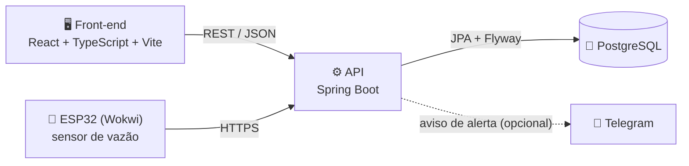
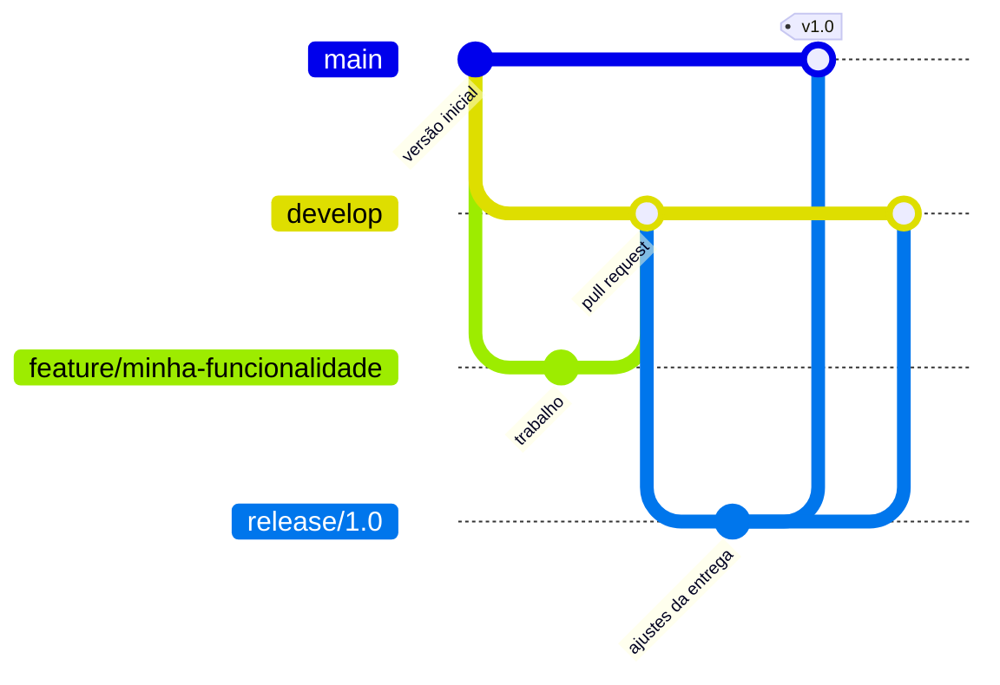

<p align="center">
  
</p>

<h1 align="center">Águas do Capibaribe</h1>

<p align="center">
  <strong>Cada lote com a água que ele precisa. Nem uma gota a mais.</strong><br>
  Gestão do consumo de água por lote em lavanderias de jeans do Agreste Pernambucano.
</p>

<p align="center">
  <a href="https://github.com/paulomourz/aguas-do-capibaribe/actions/workflows/ci.yml"></a>
  <a href="https://github.com/paulomourz/aguas-do-capibaribe/actions/workflows/qualidade.yml"></a>
  <a href="https://sonar.fchicout.dev/dashboard?id=aguas-do-capibaribe"></a>
  <a href="https://github.com/paulomourz/aguas-do-capibaribe/tags"></a>
</p>

<p align="center">
  
  
  
  
  
  
  
</p>

<p align="center">
  <a href="https://aguas-do-capibaribe.onrender.com"><strong>Abrir o site</strong></a> ·
  <a href="#-rodar-em-1-comando"><strong>Rodar em 1 comando</strong></a> ·
  <a href="#-sobre-o-projeto">Sobre</a> ·
  <a href="#-funcionalidades">Funcionalidades</a> ·
  <a href="#-arquitetura">Arquitetura</a> ·
  <a href="#-como-rodar">Como rodar</a> ·
  <a href="#-testes">Testes</a> ·
  <a href="#-status">Status</a> ·
  <a href="#-fluxo-de-trabalho-gitflow">GitFlow</a> ·
  <a href="#-equipe">Equipe</a>
</p>

---

## ⚡ Rodar em 1 comando

Só precisa do [Docker](https://docs.docker.com/get-docker/) com o Docker Compose. Depois do `git clone`, na raiz do
projeto:

```bash
docker compose up --build
```

- Sobe o **banco** (PostgreSQL 18), a **API** (Spring Boot) e o **site** (React), sem configurar nada e sem `.env`.
- No meio do log aparecem os **logins e as senhas** do administrador (`capibaribe.admin`), do gestor e do sensor,
  sorteadas na primeira subida. Para ver de novo: `docker compose logs segredos`.
- Abra o site em <http://localhost:3000> e o Swagger em <http://localhost:3000/api/swagger-ui.html>.
- A primeira vez baixa as imagens e compila tudo: precisa de internet e leva alguns minutos.
- **Ctrl+C** para tudo. Para rodar em segundo plano: `docker compose up -d --build`. Mais detalhes em
  [Com Docker](#com-docker-um-comando-só).

## 💧 Sobre o projeto

As lavanderias de jeans de **Toritama**, **Caruaru** e **Santa Cruz do Capibaribe** consomem muita
água e quase sempre sem controle por processo de lavagem. O **Águas do Capibaribe** compara, lote a
lote, a água gasta com a meta de cada processo e avisa quando o consumo foge do esperado.

> Projeto Integrador do Senac. Os relatórios são gerenciais e não têm validade jurídica.

| | Endereço |
|---|---|
| 🌐 **Site** | <https://aguas-do-capibaribe.onrender.com> |
| ⚙️ **API** | <https://aguas-api-a0vq.onrender.com/api> |
| 📚 **Swagger** | <https://aguas-api-a0vq.onrender.com/api/swagger-ui.html> |

No plano grátis, a API dorme sem uso e leva cerca de 2 minutos para acordar. Se o login der erro de conexão,
espere um pouco e tente de novo.

📘 **Guia completo em PDF** (como o sistema funciona e como rodar):
[`docs/guia/guia-aguas-do-capibaribe.pdf`](docs/guia/guia-aguas-do-capibaribe.pdf)

🎤 **Para apresentar ou testar:** [roteiro com os planos A e B](docs/guia/roteiro-apresentacao.md)

> **Não registre lote de Estonagem no site publicado.** A massa da demonstração deixa a Estonagem com 2 lotes
> seguidos acima da meta, e o 3º vem do sensor no Wokwi, ao vivo, para abrir o alerta e avisar no Telegram. Um lote
> acima da meta antes disso antecipa o alerta, e um dentro da meta zera a sequência. Se acontecer, limpe o banco e
> rode a massa de novo ([como fazer](docs/guia/roteiro-apresentacao.md#preparar-a-área-de-demonstração)).

🗄️ **Para a disciplina de Banco de Dados:** [roteiro do plano C](docs/guia/roteiro-banco-de-dados.md)
([PDF](docs/guia/roteiro-banco-de-dados.pdf)), com o banco aberto ao pgAdmin, o log de todo SQL e
[todos os testes do banco](database/demonstracao/testes-banco-plano-c.sql) prontos para rodar

## ✨ Funcionalidades

| | Funcionalidade | Como funciona |
|---|---|---|
| 🎯 | **Metas por processo** | Litros por lote ou por peça para cada processo (estonagem, tingimento, amaciamento…) |
| 📝 | **Registro de lotes** | Digitado pelo operador ou enviado pelo sensor; o banco calcula o esperado |
| 📊 | **Desvio automático** | Realizado × meta em %, com faixas dentro da meta, atenção e crítico |
| 🚨 | **Alertas** | Abertos quando 3 lotes seguidos do mesmo processo passam da meta |
| 📈 | **Dashboard e relatório mensal** | Gráficos de meta e consumo por processo e por dia, e relatório mensal com download em PDF |
| 🔔 | **Aviso no Telegram** | Quando um alerta abre, chega uma mensagem no grupo da lavanderia, com o link do alerta |
| 📤 | **Exportação em CSV** | O histórico filtrado vira uma planilha para auditoria externa (CPRH) |
| 👥 | **Perfis** | Administrador (tudo, mais usuários e auditoria), gestor (operação), operador (registra lotes) e sensor (só envia lotes e telemetria) |
| 🔍 | **Auditoria** | Quem criou, desativou, reativou ou redefiniu a senha de cada conta, sem poder ser apagado |
| 📶 | **Funciona com a Wi-Fi oscilando** | O site é um PWA: abre sem conexão, guarda os lotes no aparelho (IndexedDB) e envia sozinho quando a conexão volta, sem duplicar |
| 📡 | **Sensor IoT** | ESP32 simulado no Wokwi mede a vazão e envia o lote pela API. Há um projeto público, em HTTPS, e um local, para o Docker |

## 🧱 Arquitetura



- O front-end **nunca** acessa o banco: tudo passa pela API.
- O ESP32 simulado é só mais um cliente da API: faz login e envia o lote.
- Publicado com site e API no [Render](https://render.com) e banco no [Neon](https://neon.com). O Render só publica
  depois que o CI passa e confere a saúde da API em `/api/actuator/health`. Para rodar tudo no próprio PC, use o Docker.
- O esquema é versionado com Flyway: as migrações em
  [`backend/src/main/resources/db/migration/`](backend/src/main/resources/db/migration/) são aplicadas
  pela API ao subir ([`database/LEIA-ME.md`](database/LEIA-ME.md)).

### Estrutura do repositório

| Pasta | Conteúdo |
|---|---|
| `/` (raiz) | Front-end React 19 com TypeScript + Vite + Tailwind (estrutura exigida pelo Figma Make) |
| [`backend/`](backend/README.md) | API REST em Java 25 LTS + Spring Boot 3.5 |
| [`database/`](database/LEIA-ME.md) | Guia do banco, script do usuário `aguas_api`, backup e restauração, e scripts de desempenho (as migrações Flyway ficam no `backend/`) |
| [`iot/`](iot/LEIA-ME.md) | Sensor de vazão simulado no Wokwi (ESP32): código, circuito e guia |
| [`docs/`](docs/README.md) | [Guia em PDF](docs/guia/), [endpoints da API](docs/tecnico/api.md), [banco e servidor](docs/tecnico/banco-remoto.md), [validação com usuário](docs/validacao/LEIA-ME.md), [arquitetura](docs/tecnico/arquitetura.md), [testes](docs/tecnico/testes.md) e [gestão: TAP, ERS, segurança e ciclo de vida](docs/gestao/LEIA-ME.md), cada um na sua norma ISO/IEC |
| `e2e/` | Teste de ponta a ponta do modo offline (Playwright) |
| [`testes-carga/`](docs/tecnico/teste-carga.md) | Teste de carga do registro de lotes (k6) |
| `public/` | Arquivos servidos como estão (favicon) |
| `.figma/` | Configuração do Figma Make. Não editar |
| [`CHANGELOG.md`](CHANGELOG.md) | Histórico de versões |

## 🚀 Como rodar

> [!IMPORTANT]
> **Trabalhe na `develop`.** Ela é a branch padrão do repositório, então o `git clone` já traz a `develop`; a `main`
> só recebe as versões entregues.
>
> ```bash
> git clone https://github.com/paulomourz/aguas-do-capibaribe.git
> cd aguas-do-capibaribe
> ```
>
> Depois siga os passos abaixo: requisitos, banco, API e front-end. O banco do seu PC começa só com a
> estrutura e os processos iniciais das migrações, e os arquivos de senha (`backend/.env`, `.env.local`) não vêm do GitHub:
> cada pessoa cria os seus a partir dos `.env.example`.

### Com Docker (um comando só)

Precisa apenas do Docker com o Docker Compose. Na raiz do projeto:

```bash
docker compose up -d --build
docker compose logs segredos   # mostra os logins e as senhas do administrador, do gestor e do sensor
```

O site abre em <http://localhost:3000> e o Swagger em <http://localhost:3000/api/swagger-ui.html>. A primeira
subida baixa as imagens e compila tudo, então precisa de internet e demora alguns minutos.

- **Banco próprio:** é separado do PostgreSQL instalado no PC e já vem com os processos iniciais.
- **Senhas:** são sorteadas na primeira subida e ficam só em volumes do Docker, fora do Git. A API as lê como
  arquivos só de leitura em `/run/secrets/aguas` (padrão do Docker Secrets), então nenhuma senha aparece nas
  variáveis de ambiente do contêiner; o CI confere isso a cada mudança.
- **Parar:** `docker compose down` mantém os dados. Com `docker compose down -v`, os dados e as senhas são **apagados**.
- **Contas prontas:** `capibaribe.admin` (administrador), `capibaribe.gestor` (gestor) e `sensor.wokwi` (sensor).
- **Wokwi com o Docker:** `docker compose --profile tunel up -d --build` liga também o túnel, e `docker compose --profile tunel stop tunel` desliga. Veja o [roteiro de apresentação](docs/guia/roteiro-apresentacao.md).

Para rodar sem Docker, siga os passos abaixo.

### Requisitos

| Ferramenta | Versão | Para quê |
|---|---|---|
| JDK | 25 (LTS) ou mais novo | API |
| Maven | 3.9 ou mais novo | API |
| PostgreSQL | 18 | banco |
| Node.js | 22 ou mais novo | front-end |
| pnpm | 10 | front-end (`npx pnpm@10` também serve) |
| cloudflared | qualquer | só para ligar o IoT simulado à API do seu PC, sem Docker |

### 1. Banco de dados

Crie um banco vazio, aplique as migrações do Flyway e crie o usuário da aplicação (`aguas_api`, sem
permissão de apagar dados nem de mudar a estrutura). Escolha uma senha para ele: é a que vai no
`DB_PASSWORD` do `backend/.env`. PowerShell, dentro de `backend/`:

```powershell
psql -U postgres -c "create database aguas"
$env:FLYWAY_URL = "jdbc:postgresql://localhost:5432/aguas"; $env:FLYWAY_USER = "postgres"; $env:FLYWAY_PASSWORD = "<senha do postgres>"
mvn flyway:migrate
psql -U postgres -d aguas -v ON_ERROR_STOP=1 -v papel=aguas_api -v banco=aguas -v senha='<senha do aguas_api>' -f ../database/seguranca-usuario-api.sql
```

No fim, o último comando mostra o que o `aguas_api` pode fazer em cada tabela (nenhum `delete`).

> **Já tem o banco de antes do Flyway (criado pelo antigo `banco.sql`)?** Não recrie: na primeira subida
> da API nova, use `FLYWAY_BASELINE=true` uma vez
> ([`database/LEIA-ME.md`](database/LEIA-ME.md#banco-que-já-existia-antes-do-flyway-o-aguas)).

O banco começa sem usuários. Na primeira inicialização, a API cria o administrador principal
`capibaribe.admin` com a senha de `ADMIN_SENHA` ([detalhes](backend/README.md#administrador-principal));
os outros usuários são criados na tela **Usuários**.

> **Contas fixas:** `capibaribe.admin` (administrador), `capibaribe.gestor` (gestor, criada se `GESTOR_SENHA` estiver
> definida) e `sensor.wokwi` (sensor, criada se `SENSOR_SENHA` estiver definida). Os processos reais são cadastrados pelo site. As senhas ficam fora do Git.
> Situação atual: [`docs/tecnico/banco-remoto.md`](docs/tecnico/banco-remoto.md#6-situação-atual).

### 2. API

```bash
cd backend
cp .env.example .env     # preencha banco (DB_USER=aguas_api), FLYWAY_USER/FLYWAY_PASSWORD, JWT_SECRET, ADMIN_SENHA e CORS_ORIGINS
mvn spring-boot:run      # http://localhost:8080/api
```

Com a API no ar, a documentação interativa (Swagger) fica em
**http://localhost:8080/api/swagger-ui.html**: lista as 19 rotas e permite testá-las no navegador.
Configuração completa, regras implementadas e testes: [`backend/README.md`](backend/README.md).

### 3. Front-end

```bash
pnpm install
pnpm dev                 # http://localhost:8443
```

O site **sempre usa a API**: sem configuração nenhuma, ele procura em `http://localhost:8080/api`. Se a
API estiver em outro endereço, ou para pôr o nome da lavanderia no relatório em PDF, crie o
`.env.local` na raiz a partir do `.env.example` (salve em UTF-8 sem BOM):

```
VITE_API_URL=http://localhost:8080/api
VITE_NOME_LAVANDERIA=Nome da lavanderia
```

Com a API desligada, o site avisa "Não foi possível conectar ao servidor." em vez de quebrar.

#### Sem conexão (PWA)

No build de produção (`pnpm build`, Docker, Render) o site instala um service worker
([`vite-plugin-pwa`](https://vite-pwa-org.netlify.app/)) e passa a abrir mesmo com a Wi-Fi da lavanderia fora:

- **Lote registrado sem conexão** fica guardado no aparelho (IndexedDB, `src/services/filaOffline.ts`) e aparece em
  **Registro de lotes → Guardados neste aparelho** e no aviso amarelo do cabeçalho.
- **A conexão voltou?** O site envia sozinho (evento `online`, a cada 20 s e ao voltar para a aba), do mais antigo
  ao mais novo, ou na hora pelo botão **Enviar agora** (`src/services/sincronizacao.ts`).
- **Sem duplicar:** cada lote leva uma chave (UUID) no cabeçalho `Idempotency-Key`; se a resposta se perder e o site
  reenviar, a API devolve o lote já gravado. Ver [`docs/tecnico/api.md`](docs/tecnico/api.md#reenvio-sem-duplicar-idempotency-key).
- **Página recarregada sem conexão:** abre com a sessão, os processos e os lotes da última carga. Ao sair, esses dados
  são apagados do aparelho; os lotes ainda não enviados ficam e vão quando a mesma pessoa entrar de novo.
- **Lote recusado** pela API (ex.: processo inválido) fica marcado em vermelho para o operador tentar de novo ou descartar.
- No `pnpm dev` o service worker fica desligado; a fila em IndexedDB funciona igual.
- Uma versão nova do site só assume quando todas as abas forem fechadas, para nunca recarregar no meio de um registro.

> **Sem modo simulado:** o site sempre usa a API. Para mostrar o sistema sem internet, suba tudo no computador com o
> Docker (plano B do [roteiro de apresentação](docs/guia/roteiro-apresentacao.md#plano-b-docker-no-computador)).

### 4. IoT simulado (opcional)

Um ESP32 no [Wokwi](https://wokwi.com) mede a vazão, conta os litros do lote e envia o lote para a API
por HTTPS. Guia completo: [`iot/LEIA-ME.md`](iot/LEIA-ME.md).

## 🧪 Testes

```bash
cd backend
mvn test
```

| Conjunto | Precisa de banco? | Cobre |
|---|---|---|
| `RegraDeAlertaTest`, `RegrasSimplesTest` | não | regra dos 3 lotes, transições de status, desvio, CORS, JWT |
| `SegurancaWebTest`, `LimiteDeRequisicoesTest` | não | 401/403 por perfil, validações, formato de erro, limite de requisições (429) |
| `ProcessoControllerTest`, `ProcessoServiceCacheTest` | não | cadastro de processos e cache da lista |
| `AuditoriaUsuarioTest`, `AuditoriaServiceTest` | não | registro e consulta da auditoria |
| `AdminInicialTest`, `GestorInicialTest`, `SensorInicialTest` | não | contas criadas na inicialização |
| `AvisoDeAlertaTest`, `DisjuntorDoTelegramTest` | não | mensagem do Telegram, falha no envio sem afetar o lote e disjuntor |
| `TelemetriaControllerTest`, `SensorWokwiHealthIndicatorTest` | não | validação da telemetria (400, 401) e saúde do sensor |
| `DescarteControllerTest`, `DescarteServiceTest`, `PrecoM3ControllerTest` | não | descarte de efluentes (validação e acesso por perfil) e preço do m³ |
| `IntegracaoPostgres*Test` | Docker ou banco temporário `*_teste` | fluxo completo num banco real, perfis, auditoria, Actuator e aviso no Telegram (com um servidor falso) |
| `CicloCompletoLavanderiaE2ETest` | Docker ou banco temporário `*_teste` | jornada completa por HTTP: login, processo, operador, lotes, alerta e relatório |

São 253 testes: 209 unitários e de web + 44 de integração e de sistema com PostgreSQL 18 (o banco começa vazio e o
Flyway aplica todas as migrações). Os de integração usam um
banco temporário, criado e apagado na hora, **nunca** o `aguas`. Passo a passo em
[`backend/README.md`](backend/README.md#testes).

**Site:**

```bash
pnpm test        # Vitest (346 testes): fila em IndexedDB, sincronização e envio em segundo plano, CSV, planilha, tema, glossário, números, gauge, pegada, limites, esqueletos, descartes e custo da água
pnpm test:e2e    # Playwright (26 testes): modo offline, Background Sync, fluxo do operador e do alerta, efluentes, planilha, privacidade, números, carregamento e acessibilidade (axe-core)
```

O teste ponta a ponta (`e2e/offline.spec.ts`) derruba a conexão do navegador, registra lotes, recarrega a página
ainda sem conexão, devolve a conexão e confere que a API recebeu cada lote uma vez só, na ordem. Também simula a
resposta perdida (a API grava, o site não recebe) e confere que o reenvio não duplica. Na primeira vez, rode
`pnpm exec playwright install chromium`.

A CI ([`.github/workflows/ci.yml`](.github/workflows/ci.yml)) roda em todo push e PR para `main` e
`develop`: `backend-test` (no Java 25), `frontend-build` (`tsc --noEmit`, `pnpm test`, `pnpm build` e `pnpm test:e2e`) e
`docker-compose` (sobe o Docker com o plano C, testa login, processos e registro de lote pelo Nginx e roda o script da aula de banco de dados) e `dependencias` (procura
vulnerabilidades conhecidas no `pom.xml` e no `pnpm-lock.yaml` com o [OSV-Scanner](https://google.github.io/osv-scanner/)
e bloqueia as de gravidade alta ou crítica, CVSS 7,0 ou mais; exceções, sempre com motivo e data, ficam em
[`osv-scanner.toml`](osv-scanner.toml)). O Render só publica depois
que esses checks passam. **Não faça merge com check vermelho.**

### Se uma publicação der problema (voltar versão)

1. **Na hora, no Render:** abra o serviço (`aguas-api` ou o site), vá em **Events**, escolha o último deploy que
   funcionava e clique em **Rollback**. A versão anterior volta ao ar em poucos minutos.
2. **Depois, no Git:** desfaça o merge com problema por um PR de `git revert` na `develop` (no GitHub, botão
   **Revert** do PR). Sem isso, o próximo merge publica o erro de novo, e o Render pode desligar o Auto-Deploy
   depois de um rollback: confira em **Settings > Auto-Deploy** que continua em **After CI Checks Pass**.
3. **Banco:** o rollback não desfaz migração do Flyway. Se o problema veio de uma migração, corrija com uma
   migração nova (próximo número livre), nunca editando a que já rodou.

O [teste de carga](docs/tecnico/teste-carga.md) (k6: 100 sensores ao mesmo tempo e turno industrial com 120) roda no
workflow "Teste de carga", disparado à mão; a [análise de índices](docs/tecnico/desempenho-indices.md) (EXPLAIN
ANALYZE) é rodada à mão.

## 📌 Status

Versão final: **v2.0.0**, para a feira **ProjetAÍ**. O código congela em 27/11/2026 (code freeze, #221) e a versão
sai na `main` com a tag `v2.0.0`; o badge **release** no topo mostra a última tag publicada. Antes dela: v1.1.0
(14/11/2026) e v1.0.0 (02/11/2026). O histórico de cada versão está no [`CHANGELOG.md`](CHANGELOG.md).

**Pronto**

- ✅ Login com limite de tentativas, quatro perfis (administrador, gestor, operador e sensor), gestão de usuários e da própria conta
- ✅ Auditoria das ações sobre contas, com tela própria para o administrador
- ✅ Processos e metas
- ✅ Registro de lote com desvio e histórico por perfil, inclusive sem conexão (PWA), e exportação em CSV
- ✅ Alertas (3 lotes seguidos acima da meta) com status e aviso no Telegram
- ✅ Dashboard com gráficos e relatório mensal, com download direto em PDF e em planilha Excel (.xlsx), e esqueletos no carregamento
- ✅ IoT fase 1: ESP32 simulado no Wokwi enviando lotes por HTTPS com token de API, encontrando o processo pelo nome; telemetria validada e gravada, sinal de vida a cada 15 s e saúde do sensor no Actuator (`/api/actuator/health/sensor`)
- ✅ Descarte de efluentes de cada lote, com visão mensal de conformidade e índice de reúso
- ✅ Custo da água: preço do m³ e custo do mês
- ✅ Identidade visual "sertão e água", com navegação por teclado e contraste WCAG 2.1 AA
- ✅ Documentação interativa da API (Swagger) em `/api/swagger-ui.html`
- ✅ API conectada ao banco com o usuário restrito `aguas_api` (sem apagar dados nem mudar tabelas)
- ✅ Versionamento do banco com migrações Flyway (V1 a V16), aplicadas ao subir a API
- ✅ Desempenho medido: teste de carga, índices com EXPLAIN ANALYZE e cache da lista de processos
- ✅ Monitoramento (Actuator) e backup do banco com restauração verificada
- ✅ Status verde, amarelo e vermelho calculado pela API, com limites de 0% e 8%
- ✅ Sistema publicado na internet, com endereço fixo e HTTPS
- ✅ Docker Compose: banco, API e site com um comando
- ✅ CI no GitHub Actions com testes da API, do site (com acessibilidade) e do Docker, vulnerabilidades, SBOM e Quality Gate no SonarQube; o Render só publica depois do CI
- ✅ Contêineres sem root, aviso do Telegram com disjuntor e runbook de recuperação de desastres ensaiado

**Limitações conhecidas**

- **Token do sensor:** é colado no projeto do Wokwi, que é público, na hora de usar, e não deve ser salvo lá. A
  conta tem o perfil sensor, que só consulta processos e envia lotes e leituras, e o administrador troca o token a
  qualquer momento.
- **Certificado do sensor:** a impressão digital vale até 20/12/2026 e precisa ser atualizada quando o Render
  renovar o certificado ([como fazer](iot/LEIA-ME.md#se-der-errado)).
- **Limites do status:** estão na API e no site, para classificar totais e médias. Se mudarem, mude nos dois.
- **Inativar processo:** ainda não existe.
- **Plano grátis:** a API dorme sem uso, e o banco pode ser apagado depois de 90 dias parado. O Render grátis bloqueia
  e-mail, por isso o aviso de alerta vai pelo Telegram.
- **Vários sensores por linha de lavagem:** adiado, com o motivo no Apêndice B da ERS (#47).
- **Validação com operador real:** não houve acesso a uma lavanderia no prazo. A validação foi feita com pessoas de
  fora da equipe e por avaliação simulada (#50); o kit em [`docs/validacao/`](docs/validacao/LEIA-ME.md) está pronto.
- **Bancada física:** não foi montada. A entrega usa a simulação; a especificação está em
  [`docs/tecnico/hardware-bancada.md`](docs/tecnico/hardware-bancada.md).

O que ainda falta alinhar com o orientador está na seção 11.1 do [TAP](docs/gestao/TAP.pdf).

## 🌿 Fluxo de trabalho (GitFlow)



| Branch | Para quê | Sai de | Volta para |
|---|---|---|---|
| `main` | versão entregue/apresentável. Ninguém faz commit direto | — | — |
| `develop` | integração do que está pronto; branch padrão do repositório | `main` | — |
| `feature/<nome>` | uma funcionalidade ou ajuste (ex.: `feature/inativar-processo`) | `develop` | `develop` (pull request) |
| `release/<versão>` | preparar uma entrega (ex.: `release/1.0`) | `develop` | `main` e `develop` |
| `hotfix/<nome>` | correção urgente no que já foi entregue | `main` | `main` e `develop` |

```bash
git checkout develop && git pull
git checkout -b feature/minha-funcionalidade
# ...commits...
git push -u origin feature/minha-funcionalidade
# abra um pull request para develop no GitHub
```

Antes do pull request, rode `mvn test` (back-end) e `pnpm build` (front-end). O pull request já abre com um modelo:
preencha o que mudou, como testou e a issue. Um PR para a `main` que não venha de `release/` ou `hotfix/` fica com
o check `base-do-pr` vermelho.

**Trabalhando numa issue:**

1. Crie a branch a partir da `develop` (ex.: `feature/status-na-api`) e escreva `Closes #N` na
   descrição do pull request.
2. Como a `develop` é a branch padrão, o GitHub fecha a issue sozinho no merge. Use `Refs #N` se a issue
   ainda não terminou.
3. **Mudou o banco?** Crie uma migração nova (`V9__descricao.sql`, o próximo número) em
   `backend/src/main/resources/db/migration/`. **Nunca edite uma migração que já está na `develop`**:
   o Flyway confere o checksum e a API não sobe. Registre a mudança no [`CHANGELOG.md`](CHANGELOG.md).
   Passo a passo no [`database/LEIA-ME.md`](database/LEIA-ME.md#mudou-o-banco-crie-uma-migração-nova).
4. Depois do `git pull` na `develop`, não precisa rodar nada no banco: a API aplica as migrações novas
   ao subir.

> [!WARNING]
> **Nunca suba segredos.** `backend/.env`, `.env.local`, `database/.env.backup` e `docs/privado/` estão no
> `.gitignore`. Senhas, `JWT_SECRET`, o token do Telegram e dados do banco ficam só nesses arquivos e nas variáveis do Render.

## 👥 Equipe

| Nome | Papel |
|---|---|
| Pedro | Full Stack / PO |
| Abraão Filipe | Back-end |
| João Bezerra | Back-end |
| Matheus Andrade | Front-end |
| Mateus Basilio | Banco de dados |
| Paulo Moura | DevOps |
| Fabio Cesar Figueiredo de Medeiros Chicout | Orientador |
