# Descrição da arquitetura

Descrição da arquitetura do Águas do Capibaribe, organizada conforme a norma **ISO/IEC/IEEE 42010** (descrição de
arquitetura de sistemas e software). A norma pede que se identifiquem as partes interessadas e as preocupações delas,
os pontos de vista usados e as visões do sistema, com as decisões e a justificativa de cada uma.

| Campo | Descrição |
|---|---|
| Sistema | Águas do Capibaribe — gestão de consumo de água por lote em lavanderias de jeans |
| Versão | 1.3, 20 de novembro de 2026 (versão 1.2.0 do sistema) |
| Requisitos | [ERS v2.0](../gestao/ERS.md) (ISO/IEC/IEEE 29148) |
| Responsáveis | Equipe Águas do Capibaribe |

## 1. Partes interessadas e preocupações

| Parte interessada | Preocupações com a arquitetura | Visão que responde |
|---|---|---|
| Operador de máquina | O registro precisa funcionar no celular e com a conexão oscilando. | Lógica (fila no aparelho), implantação |
| Gestor da lavanderia | Os números precisam estar certos e não podem ser alterados depois. | Dados, lógica (regras na API e no banco) |
| Administrador do sistema | Só quem tem permissão acessa cada função; as ações sobre contas ficam registradas. | Lógica (segurança), dados (auditoria) |
| Equipe de desenvolvimento | Código fácil de entender, testar e mudar sem quebrar o resto. | Lógica (camadas), desenvolvimento |
| DevOps | Publicar só código testado, com segredos fora do Git e um plano B sem internet. | Implantação |
| Orientador e banca | Clareza das decisões e ligação com os requisitos. | Todas; seção 7 |

## 2. Pontos de vista

| Ponto de vista | Pergunta que responde | Notação |
|---|---|---|
| Contexto | Com quem o sistema conversa? | C4 nível 1 (seção 3.1) e tabela |
| Contêineres | Quais partes rodam separadas e como conversam? | C4 nível 2 (seção 3.2) |
| Lógico | Quais são as partes do software e o que cada uma faz? | C4 nível 3 da API (seção 4.3), camadas e pacotes |
| Dados | O que é guardado, com quais regras? | Tabelas, triggers e migrações |
| Implantação | Onde cada parte roda? | Tabela de ambientes e serviços |
| Desenvolvimento | Como o código vira sistema publicado? | Fluxo de branches e CI/CD |

## 3. Visão de contexto

Os diagramas seguem o modelo **C4** (contexto, contêineres e componentes). A fonte de cada um, em Mermaid, fica em
[`diagramas/`](diagramas/), junto do SVG gerado. Para gerar de novo, na pasta `diagramas`:
`npx @mermaid-js/mermaid-cli -i <arquivo>.mmd -o <arquivo>.svg -b white`.

### 3.1 C4 nível 1: contexto



### 3.2 C4 nível 2: contêineres



### 3.3 Resumo em texto

```
  Operador / Gestor / Administrador          Sensor (ESP32 no Wokwi)
          │  navegador (PWA)                        │  HTTPS + JSON
          ▼                                         ▼
     ┌─────────────┐   HTTPS + JSON   ┌──────────────────────────┐   SQL    ┌──────────────┐
     │  Site React │ ───────────────▶ │ API REST (Spring Boot)    │ ───────▶ │ PostgreSQL 18│
     └─────────────┘                  └──────────────────────────┘          └──────────────┘
                                                   │ HTTPS (opcional)
                                                   ▼
                                          Bot API do Telegram
```

Regras do contexto:

- O site e o sensor são **clientes iguais** da mesma API. Nenhum deles fala com o banco.
- Só a API fala com o banco, com um usuário restrito (`aguas_api`).
- O Telegram é opcional: se faltar ou falhar, o resto funciona igual.

## 4. Visão lógica

### 4.1 Front-end (pasta `src/`)

| Parte | Responsabilidade |
|---|---|
| `screens/` | Uma tela por função: Acesso, Dashboard, Alertas, Relatórios, Registro de lote, Histórico, Processos, Usuários, Auditoria e Configurações. |
| `components/` | Peças reutilizáveis: interface base, gráficos, esqueletos de carregamento (`SkeletonCard`, `SkeletonChart`), fila offline, selo "Sincronizado", seletor de tema e dica do glossário. |
| `services/` | Comunicação com a API (`http.ts` e um arquivo por recurso), fila de lotes no IndexedDB (`filaOffline.ts`), sincronização e envio em segundo plano, exportação em CSV, PDF e planilha Excel (`exportToExcel.ts`, ExcelJS carregado só no primeiro clique) e tema. |
| `domain/` | Tipos, regras de apresentação (faixas de status), formatação, gráficos e glossário. |
| `store.tsx`, `router.tsx` | Estado da sessão e navegação entre telas. |

O service worker (PWA, `src/sw.ts`) guarda o site para abrir sem conexão. Os lotes registrados sem conexão ficam na
fila do aparelho e são enviados com a mesma chave de envio (`Idempotency-Key`) até a API confirmar: pela página
enquanto ela está aberta e, nos navegadores com Background Sync (Chrome, Edge, Android), pelo próprio service worker
quando a rede volta, mesmo com a aba fechada (`services/envioSegundoPlano.ts`). Para isso o token fica no IndexedDB
só enquanto houver lote esperando.

### 4.2 Back-end (pasta `backend/`, pacote `br.com.aguas`)

| Camada / pacote | Responsabilidade |
|---|---|
| `controller` | Recebe as requisições HTTP e devolve JSON: autenticação, usuários, processos, lotes, telemetria, alertas, relatórios e auditoria. |
| `service` | Regras de negócio: cálculo do desvio, regra de alerta (`RegraDeAlerta`), telemetria (`TelemetriaService`), relatórios, usuários e auditoria. |
| `repository` | Acesso ao banco com Spring Data JPA. |
| `entity`, `dto` | Modelo de dados e formatos de entrada e saída da API. |
| `security` | JWT, token de API do sensor (`FiltroTokenDeApi`, `TokenDeApi`), perfis, limite de requisições (`FiltroDeLimite`, `Limitador`) e respostas 401/403 no formato da API. |
| `notificacao` | Aviso de alerta no Telegram, enviado depois do commit e em outra thread, com até 3 tentativas, dentro de um disjuntor (Resilience4j); o que não chega fica em `aviso_pendente` e é reenviado pelo `ReenvioDeAvisos` a cada 5 minutos. |
| `monitoramento` | Saúde do sensor no Actuator (`SensorWokwiHealthIndicator`), pela hora da última telemetria, fora da saúde principal (`SaudeDoSensorForaDaRaiz`). |
| `exception` | Formato único de erro `{codigo, mensagem, campos}`. |
| `config` | Segurança, cache, documentação (Swagger) e criação das contas iniciais. |

A dependência segue sempre o mesmo sentido: `controller → service → repository → banco`.

### 4.3 C4 nível 3: componentes da API



- **Segurança:** toda requisição passa pelo filtro JWT, que lê o perfil no banco, e depois pelo `FiltroDeLimite`, um
  *token bucket* (Bucket4j) por IP no login e por usuário no envio de lotes. Acima do limite, a resposta é 429 com
  `Retry-After`.
- **Avisos:** a `RegraDeAlerta` publica o evento `AlertaAberto`. O `AvisoDeAlerta` só o recebe depois do commit e
  manda a mensagem ao Telegram em outra thread, então o registro do lote nunca espera nem depende do Telegram. A
  chamada passa por um disjuntor: com 50% ou mais de falhas nas últimas 10 chamadas, ele abre, e o aviso vai direto
  para `aviso_pendente`, sem esperar a rede; depois de 1 minuto, uma chamada de teste confere se o Telegram voltou.
  Respostas 401 e 400 (token ou grupo errado) não abrem o disjuntor, para o erro continuar visível.
- **IoT:** o sensor ESP32 é um cliente igual ao site e passa pelos mesmos filtros, com o perfil `sensor`. Ele se identifica por um token de API (`FiltroTokenDeApi`), cujo SHA-256 fica no banco; o administrador troca o token em Usuários. Além dos lotes, ele envia leituras de vazão por `POST /telemetria`, validadas antes da regra de negócio (400 `TELEMETRIA_INVALIDA`) e gravadas na tabela `telemetria`. A hora da última leitura dá a saúde do sensor em `/api/actuator/health/sensor`, que fica fora da saúde principal: um sensor parado não faz o Render reiniciar a API. O diagrama acima é de 10/11/2026 e ainda não mostra o filtro do token, o reenvio dos avisos, o disjuntor nem a telemetria.

## 5. Visão de dados

| Elemento | Regra |
|---|---|
| `usuario`, `processo`, `lote`, `alerta`, `alerta_lote`, `auditoria_usuario` | Tabelas principais (detalhe na ERS, seção 3.5). |
| `aviso_pendente` | Avisos do Telegram que não chegaram; o `aguas_api` só lê, insere e atualiza as colunas do reenvio (V10 e V11). |
| `efluentes_descarte` | Descarte de efluentes de cada lote (volume, pH, turbidez, % reaproveitado) para a CPRH e a ISO 14001; o `aguas_api` só lê e insere (V12). |
| `telemetria` | Leituras de vazão do sensor (processo, usuário, vazão e hora do servidor); só recebe INSERT, com índices pela data e por processo (V14). |
| `usuario.token_hash` | SHA-256 do token de API das contas de sensor, único (V9). |
| `trg_lote_esperado` | O banco calcula o esperado de cada lote pela meta do momento. |
| `trg_lote_imutavel`, `trg_auditoria_imutavel` | Lote e auditoria não podem ser alterados nem apagados, nem pela API. |
| `v_historico_lotes`, `v_alertas` | Visões que entregam o desvio já calculado. |
| Migrações Flyway V1 a V14 | O esquema muda só por migração nova, aplicada pelo dono do banco. A API só confere o esquema ao iniciar. A V13 deixa o autovacuum mais frequente nas tabelas que mais recebem linhas ([manutenção do banco](manutencao-banco.md)). |
| Usuário `aguas_api` | Lê e grava, mas não pode apagar dados nem mudar o esquema. |

## 6. Visão de implantação

| Ambiente | Site | API | Banco | Uso |
|---|---|---|---|---|
| Publicado | Render (site estático, HTTPS) | Render (contêiner Docker distroless, HTTPS, checagem em `/api/actuator/health`) | Neon (PostgreSQL 18) | Uso real e apresentação (plano A) |
| Local com Docker | contêiner `frontend` (Nginx sem root, porta 3000) | contêiner `backend` | contêiner `db` | Plano B sem internet e testes |
| Desenvolvimento | Vite na porta 8443 | Spring Boot na porta 8080 | PostgreSQL local | Programar |
| CI | build e testes no GitHub Actions | testes com PostgreSQL em contêiner | contêiner temporário | Conferir cada pull request |

No Docker, o serviço `segredos` gera as senhas na primeira subida, e a API as lê como arquivos só de leitura em
`/run/secrets/aguas`, sem variáveis de ambiente. A imagem da API é distroless (só o Java 25 e o jar, sem shell e sem
root, cerca de 132 MB), e o healthcheck é uma classe Java que chama `/api/actuator/health`. Nenhum contêiner roda
como root: o site usa o `nginx-unprivileged` e o banco roda como `postgres`; todos têm `cap_drop: ALL`,
`no-new-privileges` e sistema de arquivos só de leitura. A recuperação de cada ambiente depois de um desastre está no
[runbook](runbook-disaster-recovery.md). O serviço `tunel`
(perfil `tunel`) liga o Wokwi à API local por um túnel temporário.

O pool de conexões da API com o banco tem 20 conexões por padrão, medido no teste de carga com 100 sensores
([teste-carga.md](teste-carga.md)); no Render, com 0,1 de CPU, o valor vem de `DB_POOL_MAX`.

## 7. Visão de desenvolvimento

1. Cada mudança nasce numa branch `feature/`, `fix/` ou `docs/` a partir da `develop`.
2. O pull request para a `develop` roda o CI: testes do back-end, build e testes do site (com acessibilidade), teste do
   Docker e vulnerabilidades das dependências; e também o SBOM e o Quality Gate do SonarQube.
3. Com o CI verde e o merge feito, o Render publica sozinho (Auto-Deploy "After CI Checks Pass").
4. Versões vão para a `main` por uma branch `release/`, com tag.

Detalhes dos processos em [ciclo de vida](../gestao/ciclo-de-vida.md) (ISO/IEC 12207).

## 8. Decisões de arquitetura e justificativa

| Decisão | Justificativa |
|---|---|
| API REST única para site e sensor | O sensor reaproveita as mesmas regras e validações; trocar o simulador por um dispositivo físico não muda a API. |
| Regras de integridade também no banco (triggers) | Os dados continuam corretos mesmo com erro na API ou acesso direto ao banco. |
| JWT sem sessão no servidor, com o perfil lido do banco a cada requisição | A API fica sem estado, e desativar alguém corta o acesso na hora. |
| Fila no aparelho com chave de envio | O operador registra sem conexão, e o reenvio nunca duplica o lote. |
| Aviso no Telegram depois do commit, em outra thread | O registro do lote não espera nem depende do Telegram. |
| Render e Neon nos planos grátis, com Docker como plano B | Custo zero; o Docker cobre a falta de internet ou a API dormindo. |
| Imagem distroless e segredos como arquivos | Menos coisas para um invasor usar no contêiner, e nenhuma senha nas variáveis de ambiente. |
| Disjuntor nas chamadas ao Telegram | Com o Telegram fora do ar, os avisos não ficam presos esperando a rede, e a fila de pendentes garante a entrega depois. |
| Saúde do sensor fora da saúde principal | O Render reinicia a API quando a saúde principal falha; um sensor parado não é motivo para isso. |

## 9. Correspondência com os requisitos

| Visão | Requisitos da ERS |
|---|---|
| Contexto e lógica | RF01 a RF37, RNF03, RNF08 |
| Dados | RF09, RF10, RF27, RNF07, RNF09, RNF10, RNF22 |
| Implantação | RNF06, RNF11, RNF14, RNF20, RNF21, RNF28 |
| Desenvolvimento | RNF15, RNF16, RNF24 |
