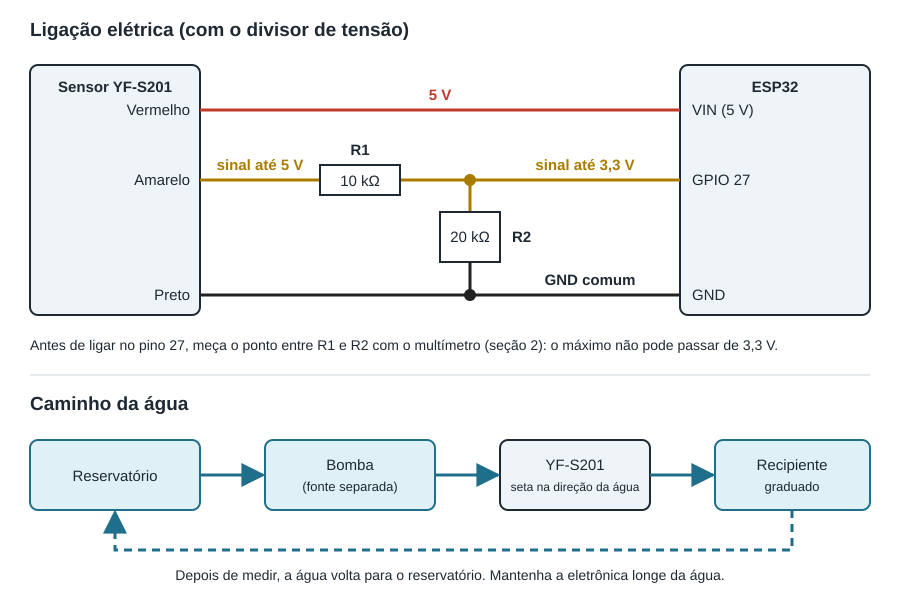

# Bancada física com ESP32 e sensor YF-S201

Especificação técnica e ponto de verificação da issue #14. Serve para a equipe e o orientador decidirem
se o projeto monta a bancada física ou entrega a simulação do Wokwi como resultado final do PI.

> **Situação:** proposta ainda não montada. Os valores de circuito e de medição são teóricos e vêm das
> especificações típicas do sensor. Confirme na folha de dados do modelo comprado e meça antes de ligar.

## 1. Peças

Preços aproximados, para orientar a decisão. Confirme na hora da compra.

| Peça | Qtde | Função | Preço estimado |
|---|---|---|---|
| ESP32 DevKit | 1 | lê o sensor e envia o lote pela API | R$ 40 a 70 |
| Sensor de vazão YF-S201 (rosca de 1/2") | 1 | mede a água | R$ 30 a 60 |
| Resistor de 10 kΩ | 1 ou 2 | R1 do divisor (ou pull-up, ver seção 2) | R$ 1 |
| Resistor de 20 kΩ | 1 | R2 do divisor | R$ 1 |
| Botão e LED, com resistor de 220 Ω no LED | 1 de cada | iniciar e encerrar o lote; indicar lote em andamento | R$ 5 |
| Protoboard e jumpers | 1 kit | ligações | R$ 20 a 30 |
| Bomba de água e fonte própria | 1 | faz a água circular; precisa passar de 1 L/min | R$ 30 a 60 |
| Mangueira, adaptadores e abraçadeiras | 1 kit | liga a bomba ao sensor | R$ 20 a 40 |
| Reservatório e recipiente graduado | 1 de cada | guardar a água e conferir o volume | reaproveitável |
| Multímetro | 1 | conferir as tensões antes de ligar | emprestado |

**Total estimado:** de R$ 150 a R$ 270, sem contar o que a equipe já tiver.

## 2. Ligação elétrica



| Fio do sensor | Liga em | Observação |
|---|---|---|
| Vermelho | VIN (5 V) do ESP32 | com o ESP32 alimentado pela USB |
| Preto | GND do ESP32 | mesmo GND de todo o circuito |
| Amarelo (sinal) | R1 de 10 kΩ, depois GPIO 27 | R2 de 20 kΩ vai do GPIO 27 ao GND |

O pino 27 é o que o [`iot/sketch.ino`](../../iot/sketch.ino) já usa para contar os pulsos. Botão e LED
continuam nos pinos 4 e 2.

### Por que o divisor de tensão

O sensor é alimentado com 5 V, e o sinal dele pode chegar perto disso. Os pinos do ESP32 trabalham com
3,3 V e **não toleram 5 V**: ligar o sinal direto pode queimar a placa. O divisor reduz a tensão:

```text
V no pino = 5 V x R2 / (R1 + R2) = 5 V x 20 kΩ / (10 kΩ + 20 kΩ) = 3,33 V
```

### Conferência antes de ligar no ESP32

A saída do sensor muda de um fabricante para outro. Por isso, meça primeiro, com o divisor montado, o
sensor ligado em 5 V e o **fio ainda solto do pino 27**. Gire a hélice devagar, soprando ou com água, e
meça o ponto entre R1 e R2 em relação ao GND:

| O multímetro mostra | O que fazer |
|---|---|
| Alterna entre perto de 0 V e 2,5 a 3,3 V | Pode ligar no pino 27 |
| Acima de 3,3 V | Não ligue. Confira os valores e a posição de R1 e R2 |
| Fica sempre perto de 0 V ou abaixo de 2,5 V | A saída provavelmente precisa de pull-up. Tire R1 e R2, ligue o sinal no pino 27 com um resistor de 10 kΩ do sinal para o **3,3 V** (nunca para o 5 V) e meça de novo |

Se o sinal ficar instável, com contagem a mais sem água passando, use fios curtos e afaste os fios do
sinal dos da bomba.

## 3. Medição e calibração

O sensor gera um pulso a cada giro da hélice. A especificação típica é:

```text
frequência (Hz)  = 7,5 x vazão (L/min)
vazão (L/min)    = frequência (Hz) / 7,5
pulsos por litro = 7,5 x 60 = 450
litros do lote   = total de pulsos / PULSOS_POR_LITRO
```

| Vazão | Frequência |
|---|---|
| 1 L/min (mínimo típico do sensor) | 7,5 Hz |
| 10 L/min | 75 Hz |
| 30 L/min (máximo típico do sensor) | 225 Hz |

A precisão sem calibrar é de cerca de 10%, e o valor de 450 varia de uma peça para outra. Para calibrar:

1. Encha um recipiente graduado com um volume conhecido, de pelo menos 5 L, passando pelo sensor.
2. Anote o **Acumulado** que o sketch mostra no monitor serial.
3. Calcule e repita pelo menos 3 vezes, usando a média:

```text
PULSOS_POR_LITRO novo = PULSOS_POR_LITRO atual x litros mostrados / litros reais
```

Exemplo: o sketch com 450 mostrou 5,20 L e o recipiente marcou 5,00 L. O novo valor é
450 x 5,20 / 5,00 = **468**.

**Cuidado:** ao encerrar um lote, o sketch envia o lote para a API, e lotes não podem ser apagados. Faça
a calibração com um banco temporário, nunca com o banco oficial `aguas`.

## 4. O que muda do Wokwi para a bancada

| Onde | Mudança | Motivo |
|---|---|---|
| Montagem | Tirar o fio entre os pinos 25 e 27 e o potenciômetro | os pulsos passam a vir do sensor |
| `loop()` e `ajustarGerador()` | Retirar o gerador de pulsos | ele só existe para simular o sensor |
| Mensagem `Vazão: ...` no serial | Calcular a vazão pelos pulsos do último segundo | hoje ela usa `freqAtual`, que vem do gerador simulado |
| `WIFI_SSID` e `WIFI_SENHA` | Usar a rede do local | o valor atual é a rede do simulador |
| `WiFi.begin(WIFI_SSID, WIFI_SENHA, 6)` | Tirar o `6` | ele fixa o canal usado no Wokwi, e a rede real pode estar em outro |
| `API_URL` | Usar o endereço da API publicada | a comunicação segura é tratada na issue #13 |
| `PULSOS_POR_LITRO` | Usar o valor calibrado | seção 3 |
| `PROCESSO_NOME` e `PECAS` | Usar um processo de bancada | ver abaixo |

**Meta da demonstração:** uma bancada mede poucos litros, enquanto as metas reais são de lavanderia. Se
usar um processo real, o desvio sai muito abaixo da meta. Para demonstrar, cadastre um processo próprio,
por exemplo com meta de 5 L por lote. Assim, medir mais de 5 L em 3 lotes seguidos abre o alerta.

**Segurança:** mantenha a eletrônica longe da água, não alimente a bomba pelo ESP32, use uma fonte
separada para ela e só mexa nas ligações com tudo desligado.

## 5. Ponto de verificação

A decisão é da equipe com o orientador. Os campos abaixo devem ser preenchidos na reunião.

**Data:** ____/____/______

**Participantes:** ________________________________________________

| Critério | Pergunta | Situação encontrada | Atende? |
|---|---|---|---|
| Componentes | Temos ou conseguimos as peças da seção 1 a tempo? | | ☐ Sim ☐ Não |
| Orçamento | Quem paga, e o valor cabe no projeto? | | ☐ Sim ☐ Não |
| Software | O site, a API e o envio pelo Wokwi estão estáveis? | | ☐ Sim ☐ Não |
| Prazo | Sobra tempo para comprar, montar, calibrar e ensaiar antes do fim do semestre? | | ☐ Sim ☐ Não |
| Responsável | Alguém assume montar e levar a bancada para a banca? | | ☐ Sim ☐ Não |

**Regra sugerida:** avançar para a bancada só se todos os critérios forem "Sim". Com qualquer "Não", a
entrega fica com a simulação do Wokwi.

**Decisão:**

- [ ] Avançar para a bancada física
- [ ] Encerrar com a simulação do Wokwi como resultado final do PI

**Justificativa:** ________________________________________________

**Parecer do orientador:** ________________________________________

**Assinatura ou registro de aprovação:** ____________________________

### Sugestão técnica (não é a decisão)

Manter o Wokwi como entrega garantida e tratar a bancada como acréscimo, se os critérios forem atendidos.
O código de contagem de pulsos é o mesmo nos dois casos, então a simulação já demonstra a regra de negócio
sem o risco de falha de montagem no dia da banca.
