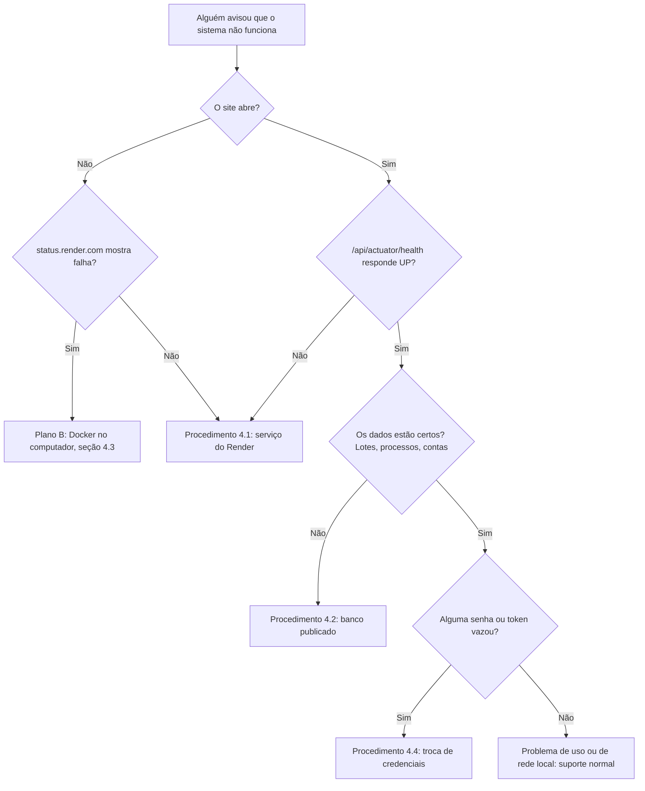

# Runbook de contingência e recuperação de desastres

Roteiro para pôr o Águas do Capibaribe de volta no ar depois de uma falha grave: API ou site fora, banco apagado ou
corrompido, ou senha vazada. Segue a ideia das normas ISO/IEC 20000 (gestão de serviços) e ISO 22301 (continuidade
de negócios): cada cenário tem como reconhecer, o que fazer passo a passo, quem chamar e como confirmar que voltou.

| Campo | Descrição |
|---|---|
| Versão | 1.0, 17 de novembro de 2026 (issue #170) |
| Metas | **RTO** (tempo até voltar) menor que 10 minutos; **RPO** (dados que podem se perder) menor que 1 minuto |
| Ambientes | Publicado (site e API no Render, banco no Neon) e Docker (plano B, no computador) |
| Responsável | DevOps (Paulo Moura) |
| Ensaio | 17/11/2026, no Docker: sistema de volta em **23 segundos**, sem perder nenhum lote (seção 6) |

## 1. Antes de um incidente

Sem estes itens, os procedimentos abaixo não funcionam. Conferir no começo de cada semana.

| Item | Como conferir |
|---|---|
| Backup recente do banco publicado | `database/backups/` tem um `.dump` de hoje ou de ontem, com o `.sha256` ao lado. O agendador roda `database/backup.sh` (ver `database/LEIA-ME.md`). |
| Cópia do backup fora do computador | O último `.dump` está no drive da equipe, com acesso restrito. |
| Acesso aos painéis | O DevOps entra no Render, no Neon e no GitHub. O acesso ao Neon e ao Render fica em `docs/privado/hospedagem.md`, fora do Git. |
| Plano B pronto | `docker compose up -d --build` funciona no computador da apresentação (Docker Desktop instalado e imagens já baixadas). |
| Senhas guardadas | As variáveis do Render (`DB_PASSWORD`, `JWT_SECRET`, `TELEGRAM_TOKEN` e as das contas iniciais) estão anotadas no cofre da equipe. |

## 2. Árvore de decisão



Regra geral: **primeiro devolver o serviço, depois investigar a causa.** Se um procedimento passar de 10 minutos sem
resultado, ir para o plano B (seção 4.3) e continuar a investigação em paralelo.

## 3. Matriz de escalonamento

| Nível | Quando | Quem age | Quem é avisado |
|---|---|---|---|
| 1 | Qualquer falha detectada | DevOps (Paulo Moura): segue este runbook | Grupo da equipe |
| 2 | Falha no banco ou dados errados | DevOps com o responsável pelo banco (Mateus Basilio) | Equipe |
| 3 | Erro na API ou no site depois de um deploy | DevOps com o responsável pelo módulo (back-end: Abraão Filipe; site: Matheus Andrade) | Equipe |
| 4 | Fora do ar por mais de 10 minutos, perda de dados ou senha vazada | DevOps e PO (Pedro) decidem o plano B e a comunicação | Lavanderia e orientador (Prof. Fábio Chicout) |

O PO é quem fala com a lavanderia: o que aconteceu, desde quando, o que fazer enquanto isso (registrar os lotes no
celular, que guarda sem conexão) e quando volta.

## 4. Procedimentos

### 4.1 API ou site fora do ar no Render

**Sinais:** o site não abre, ou `https://aguas-api-a0vq.onrender.com/api/actuator/health` não responde `UP`.

1. **Plano grátis dormindo:** a primeira requisição depois de 15 minutos parados demora cerca de 1 minuto. Abrir o
   health e esperar 1 minuto antes de concluir que caiu.
2. **Ver a causa:** no Render, abrir o serviço → **Events** (deploy falhou? reiniciou?) e **Logs** (erro de conexão
   com o banco, falta de variável, falta de memória).
3. **Deploy novo com problema:** em **Deploys**, escolher o último deploy que funcionava → **Rollback**. O Render volta
   para aquela imagem sem precisar de build.
4. **Contêiner travado, sem deploy novo:** **Manual Deploy → Restart service** (ou **Deploy latest commit**).
5. **Erro de banco nos logs:** seguir o 4.2.
6. **Confirmar:** o health responde `UP`, o login funciona e o último lote aparece no Histórico.

### 4.2 Banco publicado (Neon) apagado ou com dados errados

**Sinais:** a API sobe, mas os logs mostram erro de conexão ou de tabela, ou os dados sumiram ou estão errados.

**Caminho A: restauração no próprio Neon (menor perda de dados).** O Neon guarda o histórico do banco e restaura num
momento escolhido, dentro da janela de restauração do plano (o tamanho dela aparece no painel do Neon).

1. No Neon, abrir o projeto → **Backup & Restore** (restauração por ponto no tempo).
2. Escolher um momento **logo antes** do problema (o horário do primeiro erro nos logs do Render).
3. Restaurar o branch principal. O endereço do banco não muda, então o Render não precisa de alteração.
4. **Restart service** no Render e confirmar como no 4.1.

**Caminho B: restauração do último backup (quando o caminho A não der).**

1. Criar um banco novo e vazio no Neon (ou um projeto novo, se o anterior foi apagado).
2. Apontar `database/.env.backup` para ele (modelo em `database/env.backup.example`) e rodar:
   ```bash
   bash database/restore.sh --verificar database/backups/<último>.dump   # confere o arquivo antes
   bash database/restore.sh database/backups/<último>.dump               # restaura (só em banco vazio)
   ```
3. Recriar as permissões do usuário da API, com a senha que vai no Render:
   ```bash
   psql "<conexão do dono>" -v ON_ERROR_STOP=1 -v papel=aguas_api -v banco=aguas -v senha='<senha>' \
        -f database/seguranca-usuario-api.sql
   ```
   O script pode rodar de novo sem erro: se o usuário já existir, ele só confirma as restrições e a senha.
4. No Render, atualizar `DB_HOST` e `DB_PASSWORD` (se mudaram) e reiniciar.
5. Confirmar como no 4.1. Avisar a lavanderia dos lotes registrados depois do backup: eles precisam ser lançados de
   novo (os que estavam guardados nos celulares sem conexão são reenviados sozinhos).

### 4.3 Plano B e ambiente Docker

**Subir o sistema no computador** (Render, Neon ou internet fora):

```bash
docker compose up -d --build
docker compose logs segredos     # senha inicial do administrador
```

O site fica em `http://localhost:3000`. Para a apresentação, o roteiro completo está em
`docs/guia/roteiro-apresentacao.md`.

**Contêiner parou:** `docker compose ps` mostra qual; `docker compose logs <serviço>` mostra o motivo;
`docker compose up -d` sobe de novo. O banco, a API e o site têm `restart: unless-stopped`.

**Banco do Docker apagado ou corrompido** (o procedimento do ensaio da seção 6):

```bash
# 1. Para a API e o site e recria só o banco (o volume de senhas é mantido)
docker compose stop backend frontend db
docker compose rm -f db
docker volume rm aguas-do-capibaribe_db-dados
docker compose up -d --wait db

# 2. Restaura o último backup (database/.env.backup apontando para o banco do Docker)
bash database/restore.sh database/backups/<último>.dump

# 3. Permissões do aguas_api, com a senha que já está no volume de segredos
docker compose exec -T db psql -U postgres -d aguas -v ON_ERROR_STOP=1 -v papel=aguas_api -v banco=aguas \
  -v "senha=$(docker compose exec -T db cat /segredos/api)" -f - < database/seguranca-usuario-api.sql

# 4. Sobe tudo
docker compose up -d --wait
```

No Git Bash do Windows, os comandos com caminhos de dentro do contêiner precisam de `MSYS_NO_PATHCONV=1` na frente.

### 4.4 Senha, token ou chave vazada

Trocar na hora, mesmo sem certeza de uso indevido. Se o segredo entrou num commit, o histórico do Git guarda o valor
antigo: a troca é obrigatória.

| Segredo | Onde trocar | Efeito da troca |
|---|---|---|
| `JWT_SECRET` | Render → aguas-api → Environment (valor aleatório de pelo menos 32 caracteres) | Todas as sessões caem; cada pessoa entra de novo |
| Senha do banco (`DB_PASSWORD`, usuário `aguas_api`) | Neon → Roles → reset da senha; depois Render → `DB_PASSWORD` | A API reinicia com a senha nova |
| Senha do dono do banco (Flyway e backup) | Neon → Roles; depois `FLYWAY_PASSWORD` no Render e `database/.env.backup` | Migrações e backups usam a nova |
| Token de API do sensor | Site → Usuários → conta do sensor → **Rotacionar token** | A chave antiga para na hora; colar a nova no `TOKEN_API` do sketch do Wokwi |
| Senha de uma pessoa | Administrador → Usuários → **Redefinir senha** | A pessoa entra com a senha nova; a ação fica na auditoria |
| `TELEGRAM_TOKEN` | Telegram → @BotFather → `/revoke`; depois Render → `TELEGRAM_TOKEN` | Os avisos voltam com o token novo; os que falharem ficam pendentes e são reenviados |
| Senhas do Docker | Apagar o ambiente e subir de novo (`docker compose down -v` e `up`), restaurando um backup se precisar dos dados | O serviço `segredos` sorteia todas as senhas de novo |

Depois de qualquer troca: conferir o painel de eventos de segurança (Auditoria → Eventos de segurança) atrás de
logins estranhos e registrar o incidente (seção 7).

## 5. Metas e situação

| Meta | Ambiente | Situação |
|---|---|---|
| RTO menor que 10 min | Docker | **Atende:** 23 s no ensaio, do banco apagado ao sistema de pé |
| RTO menor que 10 min | Publicado | Rollback e restart do Render não reconstroem a imagem; o tempo ainda não foi medido num ensaio |
| RPO menor que 1 min | Publicado | Depende da restauração por ponto no tempo do Neon (caminho A), dentro da janela do plano |
| RPO menor que 1 min | Docker e caminho B | **Não atende:** a perda é tudo o que entrou depois do último backup (até 24 h com o backup diário). Os lotes guardados nos celulares sem conexão são reenviados sozinhos |

## 6. Ensaio de 17/11/2026

Feito no Docker, num projeto separado (`docker compose -p aguas-dr`), sem tocar nos dados de uso:

| Passo | O que foi feito | Tempo |
|---|---|---|
| Preparação | Subida do sistema e registro de 20 lotes pela API | — |
| Backup | `database/backup.sh`, com a verificação num banco temporário | 10 s |
| Desastre | Contêiner do banco removido e volume de dados apagado | — |
| Banco novo | `docker compose up -d --wait db` | 7 s |
| Restore | `database/restore.sh` do backup | 1 s (8 s acumulados) |
| Sistema de pé | Permissões do `aguas_api` e subida da API e do site | **23 s no total** |
| Conferência | Login do administrador e contagem dos lotes | 20 lotes antes, 20 depois |

**Achado do ensaio:** o `database/seguranca-usuario-api.sql` falhava num banco do Docker recém-criado, porque o
usuário `aguas_api` já existe nele. O script passou a criar o usuário só quando ele não existe.

## 7. Depois do incidente

1. Registrar numa issue (título começando com "Incidente"): início, fim, causa, o que foi feito, dados perdidos e quem foi
   avisado.
2. Se faltou algo neste runbook, corrigir no mesmo dia.
3. Repetir o ensaio da seção 6 depois de qualquer mudança no banco, no Docker ou nos scripts de backup.
